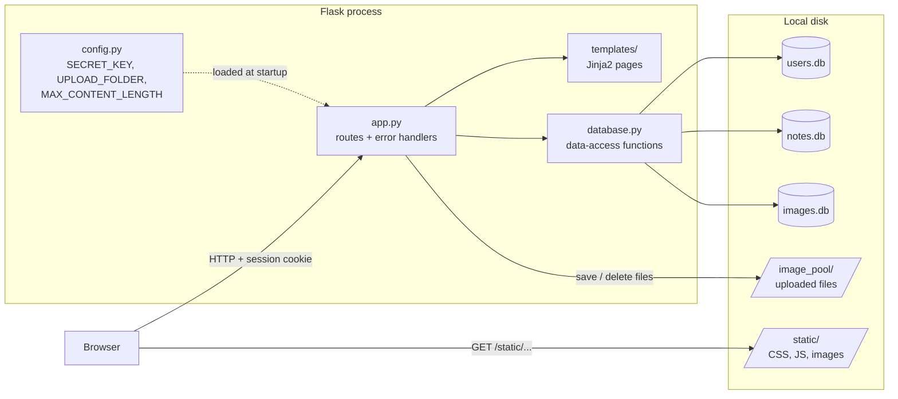
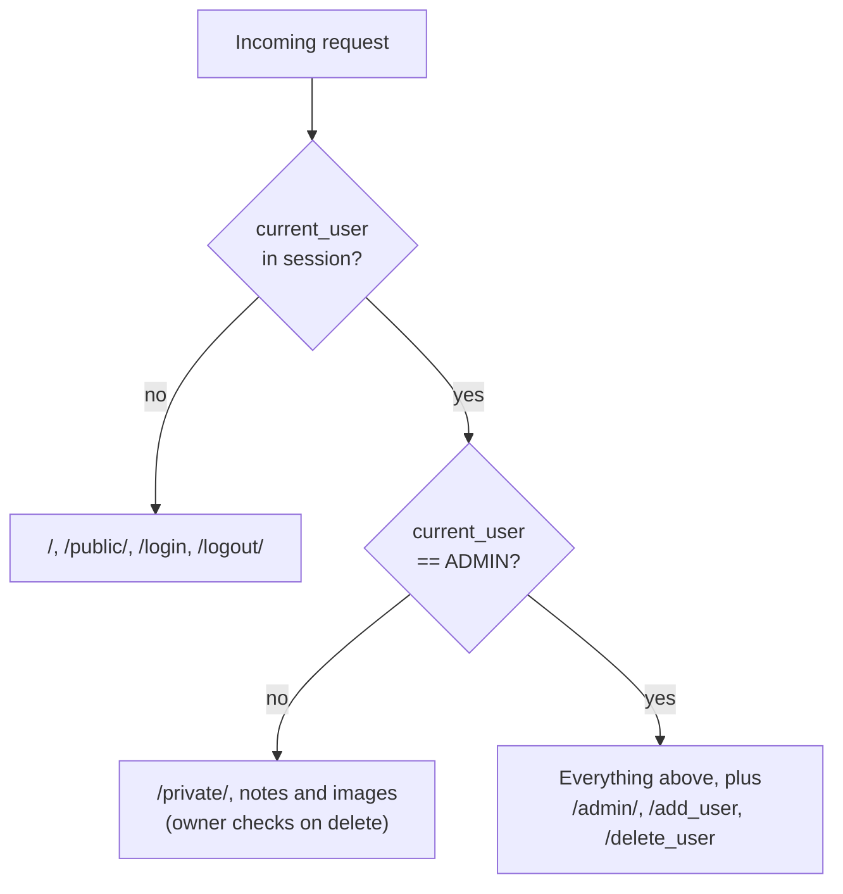
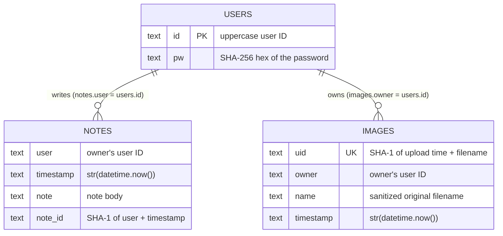
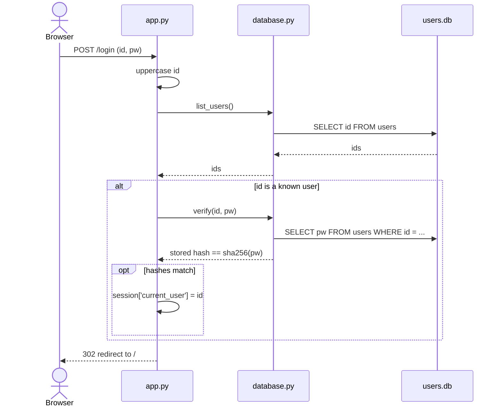
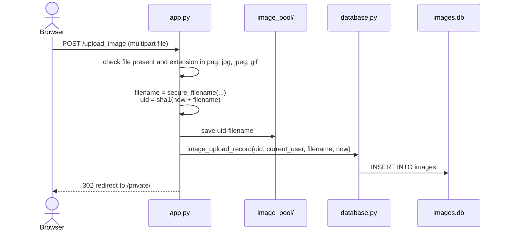
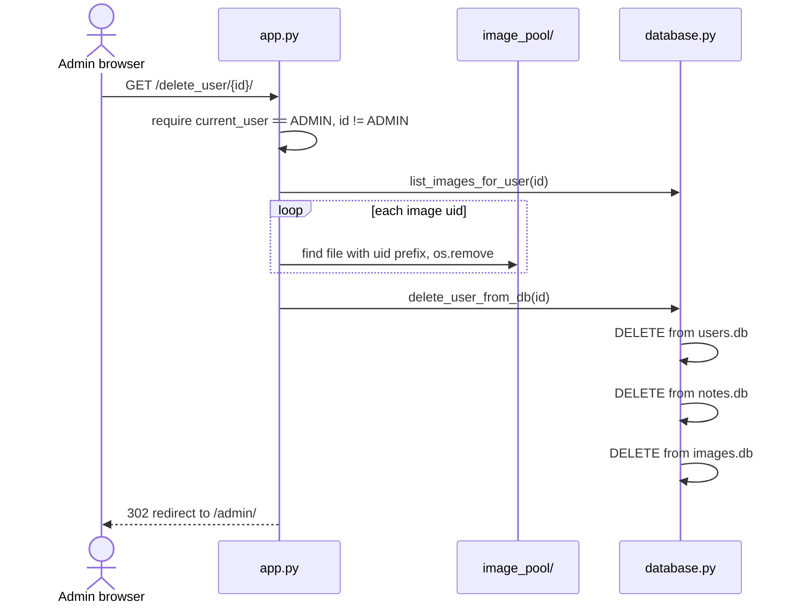
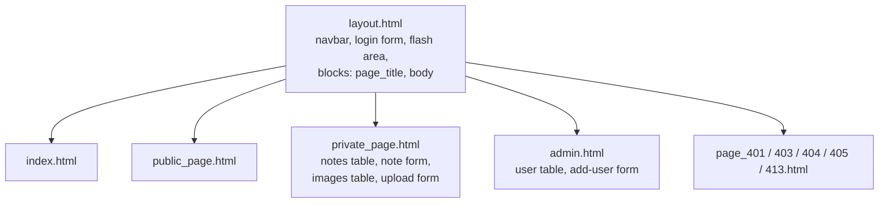

# flask-api Architecture

This document describes how `flask-api` is put together **as it exists today**: a single-module Flask app with server-rendered pages, session cookies for auth, three SQLite files, and uploaded images on local disk. It is a map for developers who are about to change the code, not a description of a target design.

> This is a training exercise and is intentionally written in a dated style. See [README.md](README.md).

## At a Glance

| Concern | Implementation |
|---|---|
| Web framework | Flask 3.1 (`app.py`), development server via `app.run()` |
| Rendering | Jinja2 templates in `templates/`, Bootstrap 3 + jQuery in `static/` |
| Auth | Flask signed-cookie session; key `current_user` holds the uppercase user ID |
| Authorization | Inline checks in each view: logged in, owner of the record, or `ADMIN` |
| Persistence | Three SQLite files in `database_file/`, accessed with raw `sqlite3` in `database.py` |
| File storage | Uploaded images written to `image_pool/` |
| Configuration | `config.py`, loaded with `app.config.from_object('config')` |
| Tests | None |

## Components



Everything runs in one process. `app.py` holds every route, does request parsing, authorization, and file handling itself, and calls into `database.py` for SQL. `database.py` opens a new connection per function call and closes it before returning; there is no connection pooling, ORM, or transaction spanning more than one call.

## Routes

| Method | Path | View function | Access | Renders / result |
|---|---|---|---|---|
| GET | `/` | `FUN_root` | Anyone | `index.html` |
| GET | `/public/` | `FUN_public` | Anyone | `public_page.html` |
| GET | `/private/` | `FUN_private` | Logged in, else 401 | `private_page.html` with the user's notes and images |
| GET | `/admin/` | `FUN_admin` | `ADMIN`, else 401 | `admin.html` with the user list |
| POST | `/login` | `FUN_login` | Anyone | Sets `session['current_user']` on success, redirects to `/` |
| GET | `/logout/` | `FUN_logout` | Anyone | Clears the session, redirects to `/` |
| POST | `/write_note` | `FUN_write_note` | No explicit check; reads `session['current_user']` | Inserts a note, redirects to `/private/` |
| GET | `/delete_note/{note_id}` | `FUN_delete_note` | Note owner, else 401 | Deletes the note, redirects to `/private/` |
| POST | `/upload_image` | `FUN_upload_image` | No explicit check; reads `session['current_user']` | Saves the file and records it, redirects to `/private/` |
| GET | `/delete_image/{image_uid}` | `FUN_delete_image` | Image owner, else 401 | Deletes the record and the file, redirects to `/private/` |
| POST | `/add_user` | `FUN_add_user` | `ADMIN`, else 401 | Adds an account, or re-renders `admin.html` with an error |
| GET | `/delete_user/{id}/` | `FUN_delete_user` | `ADMIN`, else 401; deleting `ADMIN` gives 403 | Deletes the user's files and records, redirects to `/admin/` |

Error handlers for 401, 403, 404, 405, and 413 render `page_<code>.html`. Requests larger than `MAX_CONTENT_LENGTH` (16 MB) are rejected by Flask with 413.

Uploaded images are listed on the private page by name and timestamp, but no route serves files from `image_pool/`, so they are never displayed.

### Access levels



## Data Model

Each table lives in its **own SQLite file**, so the relationships below are by convention only. There are no foreign keys, and cross-table cleanup is done by hand in `delete_user_from_db` and `FUN_delete_user`.



| File | Table | Schema source |
|---|---|---|
| `database_file/users.db` | `users` | Committed `.db` file; no schema script |
| `database_file/notes.db` | `notes` | Committed `.db` file; no schema script |
| `database_file/images.db` | `images` | Committed `.db` file; no schema script |

An uploaded image is stored on disk as `image_pool/<uid>-<filename>`. The `uid` prefix is what links a file to its row in `images.db`; deletion code finds the file by listing `image_pool/` and matching that prefix.

## Key Flows

### Login



A failed login is silent: the user is redirected home without a message.

### Image upload



The file is written before the database row, and the two steps are not coordinated, so a failure in the second step leaves a file with no record.

### Deleting a user (admin)



The cascade spans the filesystem and three databases, each in its own connection, so there is no rollback if a step fails partway through.

## Templates



`layout.html` shows the Private link only when someone is logged in, and the Admin link only for `ADMIN`. Views pass table data to templates as `zip(...)` iterators of tuples, which the templates unpack positionally (for example ``).

## Directory Layout

```text
flask-api/
├── app.py             # all routes, error handlers, upload handling
├── database.py        # SQL functions, one connection per call
├── config.py          # SECRET_KEY, UPLOAD_FOLDER, MAX_CONTENT_LENGTH
├── requirements.txt   # Flask, Werkzeug, MarkupSafe pins
├── database_file/     # users.db, notes.db, images.db (committed)
├── image_pool/        # uploaded images, named <uid>-<filename>
├── templates/         # Jinja2 templates (see above)
└── static/            # Bootstrap CSS/JS, jQuery, page images
```
